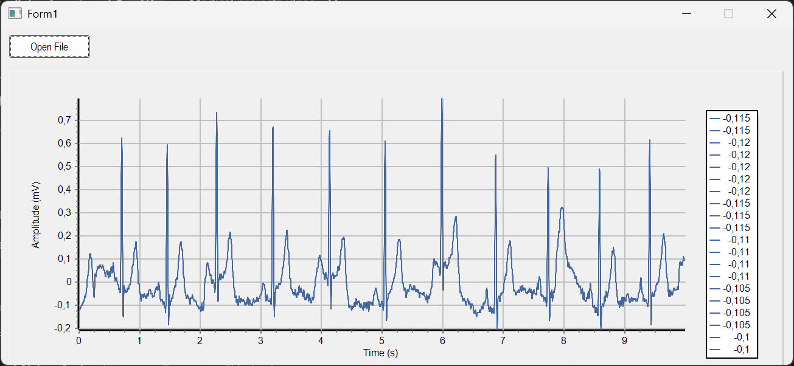

# Signal File Plotter

A Delphi VCL app that opens a signal data file and plots it against time.

## Features
- Opens a text file where each line is `time;value`, using a comma as the decimal separator (e.g. `0,002;-0,115`). Only the value after `;` is used.
- Reads up to 5000 samples
- Converts the sample index to time using `t = n / fs` with **fs = 500 Hz**
- Plots amplitude against time on a TeeChart

To plot against the sample number instead of time, change `i/fs` to `i` in `Unit1.pas` and rename the X-axis title to `Sample(s)`.

## Sample data
`filetext.txt` is an example input file.

> `StrToFloat` uses the Windows decimal separator. The sample file uses a comma, so run it with a comma-decimal locale (e.g. Indonesian) or convert the file to use dots.

## Build
Open `BukaFileLaluPlot.dproj` in Delphi (RAD Studio, Community Edition works) and run it. It needs the VCL and TeeChart.

## License
Released under the [MIT License](LICENSE).
